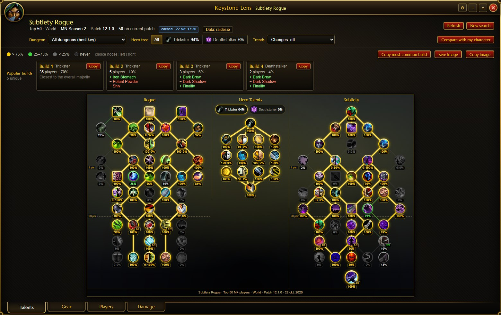
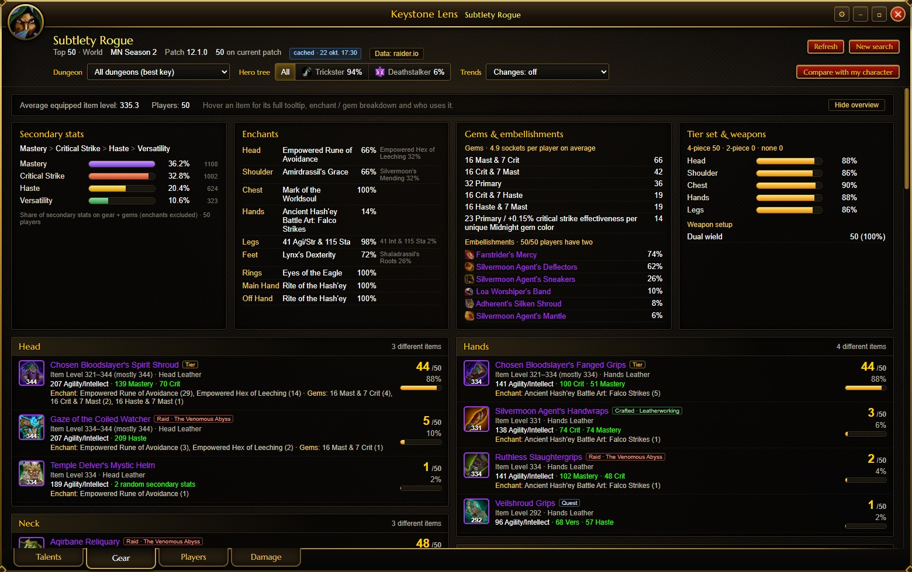
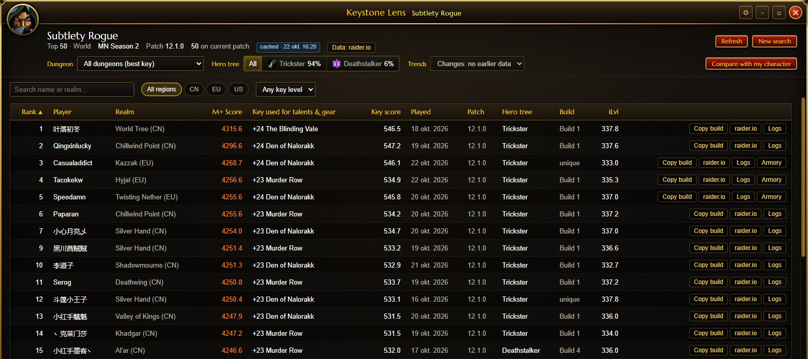

# Keystone Lens

**See what the best Mythic+ players of your spec actually run.** Keystone Lens is a free Windows app, styled like a World of Warcraft addon, that shows the talents, builds, gear and damage of the top M+ players of any retail spec:

- talent pick rates on an in-game-style talent tree;
- popular builds with copyable import strings;
- gear usage per slot, with stats, enchants, gems and where each item drops;
- damage and healing per dungeon from Warcraft Logs, compared with your own runs.



## Download

Get the latest version from the [**Releases**](https://github.com/mlvgog/keystone-lens/releases) page:

| File | What it is |
|---|---|
| `KeystoneLens-Setup-<version>.exe` | **Installer (recommended).** Adds Start menu and desktop shortcuts and an uninstaller. Installs for your user only, so no admin rights are needed. |
| `KeystoneLens-Portable-<version>.exe` | A single exe you can run from anywhere, no install. |
| `SHA256SUMS.txt` | Checksums to verify the download. |

**Windows SmartScreen.** The exe is not code-signed yet, so Windows may show "Windows protected your PC". Click **More info → Run anyway**. Releases are built from this repository by [GitHub Actions](.github/workflows/release.yml). You can compare the file's SHA-256 (`certutil -hashfile KeystoneLens-Setup-<version>.exe SHA256`) with `SHA256SUMS.txt`, or build it yourself (see below).

## Features

### Talents

- **Talent tree.** The class, hero and spec trees are laid out like the in-game talent frame. Every node shows the % of players who picked it. Choice nodes show "left | right", and multi-rank nodes show their most common rank.
- **Popular builds.** Players with nearly the same build are grouped, for example "Build 1 · Trickster · 35 players". Each build shows how it differs from the majority, and has a **Copy** button for its in-game import string.
- **Export.** Save or copy the tree as an image, for example to post on Discord.

### Gear



- **Items per slot.** Every slot lists the items used and how many players use each one, with the item's exact stats at its item level, enchants and gems. It also shows **where the item drops**: M+ dungeon, raid boss, crafted or tier. Rings and trinkets are combined. Hover an item for its full in-game tooltip.
- **Overview.** Secondary-stat profile, top enchant per slot, gems and embellishments, tier pieces and weapon setups.

### Players



- **Player list.** Every sampled player with their score, the key their data comes from, hero tree, build and item level. The list is sortable and searchable, with region and key-level filters. Each player has **Copy build** and links to raider.io, Warcraft Logs and the Armory.
- **Inspect.** Click a player to see their own talent tree and gear.

### Filters

- **Dungeon.** Each player's best key in one dungeon.
- **Hero tree.** Only players of one hero tree.
- **Trends.** Pick-rate changes since an earlier run of the same search.

### Compare with my character

- **Two ways to load your character.** Look it up on raider.io, or paste the export of the [SimulationCraft addon](https://www.curseforge.com/wow/addons/simulationcraft) (type `/simc` in game and copy the text).
  - **What the export adds.** It shows exactly what you have on right now, including the stats you chose when crafting and the stats catalysed items keep from the original item.
  - **Saved loadouts.** The talent loadouts saved in the export can be compared too: pick one in the compare bar.
- **Your build on the tree.** Your talents are overlaid on the tree: ✔ marks your picks, a red ring a popular talent you skip, and an orange ring an unusual pick.
- **Your gear.** Each gear slot shows your item and how popular it is. Hover your item for its tooltip.
- **Saved characters.** Realm names autocomplete. Characters you load are remembered, SimulationCraft imports included.

### Raid (Warcraft Logs, optional)

- **Per boss and difficulty.** Switch the class picker to **Raid**, pick a difficulty, and the app loads the top 100 logged kills of the spec on every boss of the current raid. It ranks them by damage, or by healing for healers, and reads each player's talents and gear at that kill.
- **Same views as Mythic+.** The talent tree, popular builds (with import strings), gear and players work as they do for Mythic+. The **Boss** filter shows a single boss.
- **Picked differently on a boss.** With a boss selected, a small card lists the talents the top players pick noticeably more or less there than on the other bosses. Those talents are ringed on the tree.
- **Warcraft Logs client and limits.** Raid mode needs your Warcraft Logs client (see below). One raid load is about 10 lookups. Warcraft Logs also has an hourly limit you can't see, so a few raid loads in an hour can use it up. Loaded data is kept in memory for 30 minutes and never saved.

### Damage (Warcraft Logs, optional)

- **Spec median per dungeon.** The median **DPS** (or **HPS**) of the spec in each dungeon, by key level or by item level, from logged keys on Warcraft Logs.
- **Your runs compared.** With "Compare with my character" on, every logged key of yours shows next to the spec median at the same level.

### Other

- **Settings (⚙).** Tooltip language (9 languages), default region and player count.
- **Reopen last results.** The app reopens your last results instantly.
- **Developer menu (Ctrl+Shift+D).** Download statistics per data source.

## Setting up the Damage tab

The Damage tab uses the Warcraft Logs API, which needs your own free API client. Warcraft Logs does not allow API keys to be shipped inside open-source apps.

1. Sign in at [warcraftlogs.com](https://www.warcraftlogs.com) and open <https://www.warcraftlogs.com/api/clients/>.
2. Click **Create Client** and give it a **descriptive name**, for example `Keystone Lens - <your name>`. Warcraft Logs may remove clients whose purpose isn't clear. Use `http://localhost` as the redirect URL and leave **Public Client** unchecked.
3. In Keystone Lens, open **⚙ Settings → Warcraft Logs**, paste the client ID and secret, and press **Save & test**.

The secret is stored only on your PC, encrypted for your Windows account, and is only ever sent to warcraftlogs.com.

**Usage limit.** Warcraft Logs limits how much each API client can look up per hour. Each key level in the range costs one lookup per dungeon, and the item-level view costs much more. If you hit the limit, the tab tells you when it resets.

## How players are chosen

1. **Finding players.** The app reads raider.io's published list of the season's top keys, dungeon by dungeon. It collects everyone who played the spec in those keys, then ranks them by their Mythic+ score for that spec. The top N are used (default 50, region World).
2. **Which key represents a player.** raider.io stores a snapshot of each player's talents and gear for every key they ran. The app uses each player's **highest-scoring key on the current patch**. The current patch is the newest game version in the snapshots, for example `12.1.0`. If a player has no key on the current patch, their best key overall is used, and they are marked "older patch".
3. **Tuning hotfixes.** Hotfixes don't change the game version. Choose **Keys since date…** to count only keys played after a hotfix.
4. **Skipped players.** Players with private profiles or no usable key are skipped, and the next player by score is used instead.
5. **Rare specs.** raider.io's public top-keys list covers the 2,000 best keys per dungeon. Very rarely played specs may have fewer players than requested. The header then shows, for example, "Top 7 of 50".

**How long it takes.** A first search usually takes 1–2 minutes. For a rare spec, reading all the top keys can take about 5 minutes the first time. Those pages are shared by every spec and kept for 6 hours, so later searches are much faster.

**Caching.**

| Data | Kept for |
|---|---|
| Finished analyses (reopened instantly, **Refresh** re-fetches) | 1 hour |
| Top-keys pages | 6 hours |
| Player scores and key history | 1 hour |
| Key snapshots (talents and gear per key) | forever, because they never change |
| Item sources and types, item stat data | 7 days |
| Talent trees | until the game build changes (checked daily) |
| Warcraft Logs data | 30 minutes, in memory only, never on disk |

Everything lives in `%APPDATA%\Keystone Lens`:
- `data-cache` holds the cache, which you can clear in Settings;
- `history` holds trend snapshots;
- `settings.json` holds your settings;
- `stats.json` holds the developer-menu totals.

## Data sources

Keystone Lens has no server of its own. Your PC talks to these services directly:

| Source | Used for |
|---|---|
| [raider.io](https://raider.io) | Top keys, players' scores and key history, talent and gear snapshots per key, your character, dungeon, raid and realm lists. Uses the [public API](https://raider.io/api). |
| [Wowhead](https://www.wowhead.com) | Hover tooltips for items and talents, through Wowhead's [official tooltips script](https://www.wowhead.com/tooltips). Where items drop and their type, from Wowhead's documented item XML. |
| [SimulationCraft](https://github.com/simulationcraft/simc) | Its open game data (GPL-3.0, downloaded from GitHub at runtime, not bundled): talent tree structure and item-level scaling tables. |
| [wago.tools](https://wago.tools) | Game table exports: talent positions, connections and icons, item stat allocations and bonus IDs. |
| [Warcraft Logs](https://www.warcraftlogs.com) | Damage and healing per dungeon, and your logged runs. Optional, with your own API client. |
| Icon servers | Icons from raider.io's image server, with Blizzard's as a fallback. |

Thanks to all of them for the data that makes this possible. Please respect their terms if you build on this project.

**How talent trees and item stats are built.**
- **Talent trees** combine SimulationCraft's talent data with wago.tools' game tables. They were checked node by node against another site's published trees and matched for all 40 specs.
- **Item stats** are calculated the way the game does: each item's stat allocation and bonus IDs, scaled by the item-level tables. They match Wowhead's tooltips exactly.

## Privacy

Keystone Lens has no accounts, no analytics and no telemetry. Everything it stores stays on your PC. See [PRIVACY.md](PRIVACY.md) for exactly what is stored and sent where.

## Building from source

Requires [Node.js](https://nodejs.org) 20 or newer.

```bat
start.bat
```

`start.bat` installs the dependencies on first run and launches the app. You can also run `npm install`, then `npm start`.

| Command | What it does |
|---|---|
| `npm test` | Unit tests (`node:test`) |
| `npm run dist` | Installer and portable exe in `dist\` |
| `npm run dist:installer` / `npm run dist:portable` | Only one of them |
| `npm run icon` | Regenerates `src/assets/icon.png` |

Publishing a release is described in [docs/RELEASING.md](docs/RELEASING.md).

**Optional font.** If you have WoW installed, you can copy its UI font `FRIZQT__.TTF` into `src/renderer/fonts/` for in-game-style headings when running from source. The font belongs to Blizzard, so it is not included. Without it, the bundled Marcellus font is used.

| File | Purpose |
|---|---|
| `src/main/collector.js` | Builds an analysis (raw per-player data) and loads dungeons on demand |
| `src/main/discovery.js` | Finds a spec's players in raider.io's top keys |
| `src/main/selection.js` | Which key represents a player |
| `src/main/simc.js`, `loadout.js`, `simcImport.js` | SimulationCraft export parsing, in-game talent strings (decode and encode), and your character from an export |
| `src/main/raid.js`, `raidLoader.js` | Raid mode: Warcraft Logs boss rankings as a session for the views, and boss-specific talent differences |
| `src/main/views.js` | Filtered statistics for the UI (hero tree, dungeon, build, trends) |
| `src/main/aggregate.js`, `builds.js`, `gearSummary.js`, `itemInfo.js` | Talent and gear counting, build clustering, stat profile, item source parsing |
| `src/main/throughput.js` | Damage and healing statistics |
| `src/main/history.js`, `settings.js`, `stats.js`, `cache.js` | Trend snapshots, settings, download statistics, cache |
| `src/main/sources/` | raider.io, Wowhead (item XML), Warcraft Logs clients; `talentTrees.js` and `itemData.js` build talent trees and item stats from SimulationCraft and wago.tools data |
| `src/renderer/wowhead-frame.html` | Sandboxed frame for Wowhead's tooltips script (run `node scripts/update-frame-hash.js` after editing its inline script) |
| `src/renderer/` | UI (plain HTML, CSS and ES modules) |

## Contributing

Bug reports and ideas are welcome in [Issues](https://github.com/mlvgog/keystone-lens/issues). When reporting a bug, include your version (⚙ Settings → About), the spec and the tab. Never post your Warcraft Logs client secret.

## Disclaimer

Keystone Lens is a free, non-commercial fan project. It is not affiliated with or endorsed by Blizzard Entertainment, raider.io, Wowhead, Warcraft Logs, SimulationCraft or wago.tools. World of Warcraft and Warcraft are trademarks or registered trademarks of Blizzard Entertainment, Inc. in the U.S. and/or other countries. Game data and icons belong to their respective owners.

## License

[MIT](LICENSE.txt) © 2026 Gog
